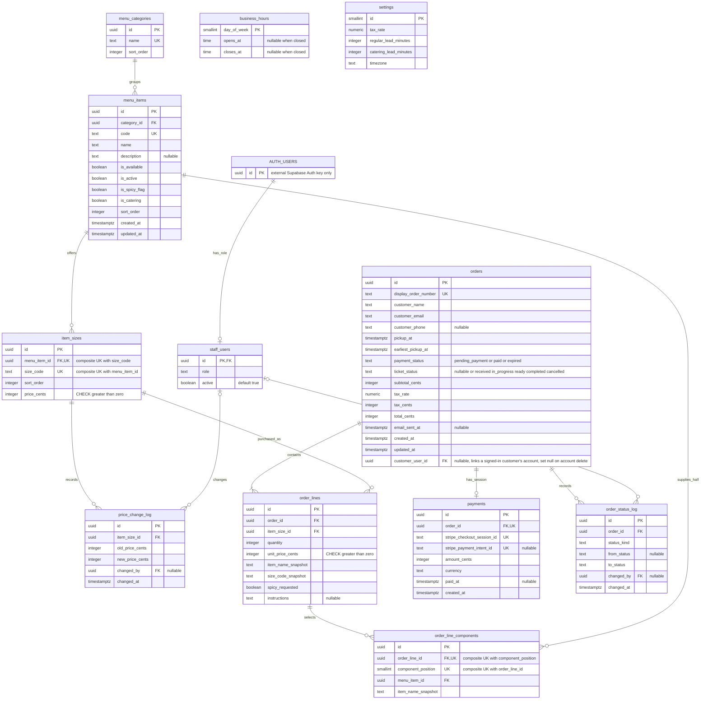

# Mermaid ERD — final model (T23 / SCRUM-62)

Updated by Perry Takyi, 12 Oct 2026, to Charles's final ERD decisions supplied for T23. The matching migration, column dictionary, nullability, constraints and source references are described in [tables-overview.md](tables-overview.md). See [database-setup.md](database-setup.md) for application instructions; the hosted database has not been changed by preparing these files.

Mermaid lists all columns from the dictionary. `PK`, `FK`, and `UK` mark keys; comments identify nullable attributes. `numeric` denotes PostgreSQL `numeric(7,6)` here. `AUTH_USERS` is the existing Supabase `auth.users` entity, shown only to make the external FK explicit; it is not an application table to create.

## Cardinality and lifecycle notes for Visio

- Each menu item belongs to exactly one category; categories can be empty. Each size belongs to one item; an orderable item must have at least one size, although an item under setup can have none.
- A completed checkout record contains one or more lines; transactional creation must guarantee that minimum because an FK alone cannot. Each line references one size, which resolves its current item; snapshots preserve the historical label and price.
- Each G1 line has exactly two component rows, and every other line has none. Mermaid's zero-to-many edge cannot express that conditional exact count. Component positions are `1` and `2`, with one half per ordered parent unit, and the parent price includes both halves.
- Each order has zero or one payment association, and each payment belongs to exactly one order. Zero is necessary while a pending order exists before its Stripe session is saved. Session and order uniqueness support idempotent webhook handling.
- Each price/status event has zero or one staff actor, allowing system events. Each staff role record refers to exactly one external Auth user; an Auth user may have no application role.
- `business_hours` and singleton `settings` are intentionally separate and unconnected. Checkout uses their current values, then stores the order's applicable tax and earliest-pickup snapshots.
- Payment: `pending_payment → paid` or `pending_payment → expired`. No refunded or cancelled payment values. One Stripe session per order; retrying an abandoned checkout creates a new order.
- Ticket: null until paid, then `received → in_progress → ready → completed`; only the owner may set final `cancelled` for a paid ticket, including a completed ticket after a Stripe refund. Cancelled cannot be reopened. CHECKs constrain both domains and enforce `ticket_status IS NULL OR payment_status = 'paid'`.
- `tax_rate` is `numeric(7,6)` in settings and orders. Item-size and order-line unit prices are strictly positive. Phone and instructions remain nullable. `payments.order_id` is unique.
- Reports exclude cancelled tickets and are online orders only. Item-level availability remains the working model; G7/G8 are intentional menu-code gaps. BR-08 keeps instructions, BR-24 requires at least six months of retention without automatic deletion, and the other retained rules add no columns.
- Only display order number format/allocation and sold-out level remain open, matching the merged T14 decisions. Sold-out active items remain publicly visible as unavailable; archived items are hidden.

These 12 application entities and all 81 columns match Charles's updated summary. Supabase's Auth table remains external. The T23 migration implements the documented schema and access rules; UI/API integration is a separate backend task.
